# Trusora

**Know who is really hiring before you apply.**

Trusora (formerly *Scam Shield*) is an internship and company legitimacy verification platform. It reads public
internship listings, analyses them for scam signals, tries to match the advertised company against official Indian
company records, and tells the student plainly what it could and could not verify.

> **Notice:** This repository contains public-facing product documentation and visual materials only. The application's source code is maintained separately in a private repository.

| | |
|---|---|
| **Status** | Under active development; not publicly launched |
| **Focus** | Internship legitimacy for students, starting with India |
| **Evidence date** | Documentation checked against the private repository on 2026-11-25 |
| **Source code** | Private |

---

## The problem

Students meet internship listings on job boards, career pages, social posts and direct messages. Some are fraudulent:
they ask for a "registration" or "training" fee, move the conversation to WhatsApp, ask for identity documents over chat,
write from a free mailbox, or copy a real posting under another company's name. Checking each one by hand takes time that
first-time applicants rarely have.

## The solution

Trusora analyses each listing before it reaches the student and shows **evidence**, not a bare verdict: the exact words
that raised a concern, what could be verified about the company, and what could not be checked.

## Main capabilities

| Capability | Status |
|---|---|
| Internship discovery from public boards and feeds, read politely (robots.txt, rate limits, no logins) | Implemented and tested |
| Filtering and 0-100 skill-match scoring | Implemented and tested |
| Rule-based scam-signal analysis that returns the matched text with each finding | Implemented and tested |
| Optional AI fee reading, with quote verification in code | Implemented; tested with a fake model only |
| Company identity checks against 3.8 million MCA company and LLP records (local mode) | Implemented and tested |
| Application tracker, follow-ups, drafted notes | Implemented and tested |
| Full verification report shown in the web interface | **Partial** (stored, not yet fully rendered) |
| Registry checks in hosted mode | **Not available** (report says *unavailable*) |
| Community scam reporting, alerts, plans | **Not built** |

Trusora keeps *verified*, *possible match*, *mismatch*, *unverified* and *unavailable* apart. It does not claim guaranteed
scam detection or universal company verification, and **unverified is not the same as fake**.

## Screenshots

Genuine screenshots from the running application (demo mode with built-in sample data and two synthetic listings; no real
user data). The interface currently carries the name "Internship Assistant" and its own violet accent. See
[`screenshots/README.md`](screenshots/README.md) for how they were made and what could not be captured.

| | |
|---|---|
| 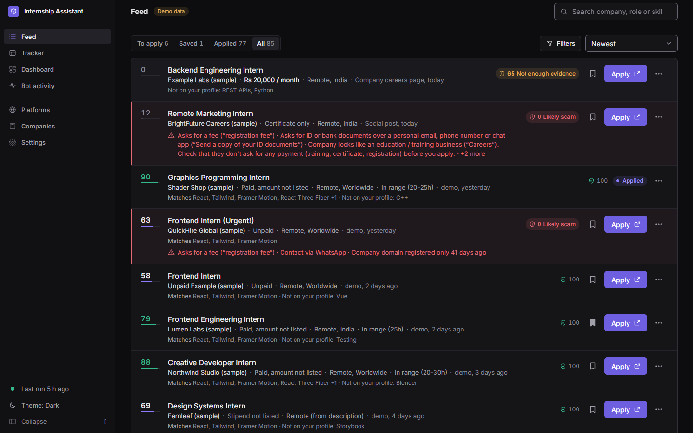 **Feed with verification marks.** Amber *Not enough evidence*, red *Likely scam* with reasons, green checks. | 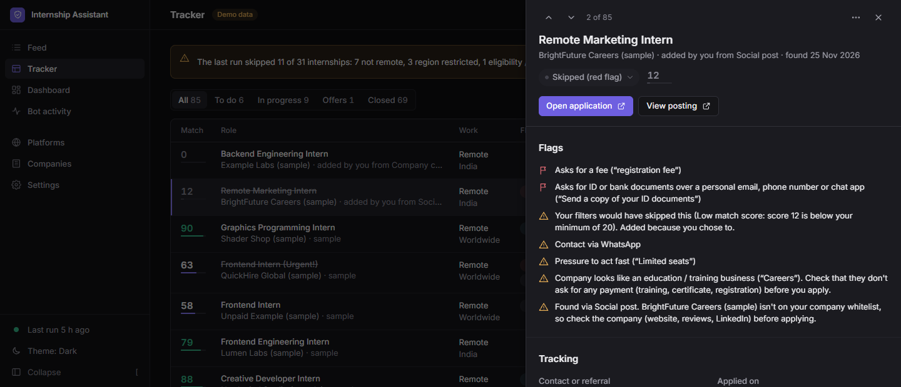 **Risk analysis.** Each flag in plain language, for a synthetic fee-demanding listing. |
| 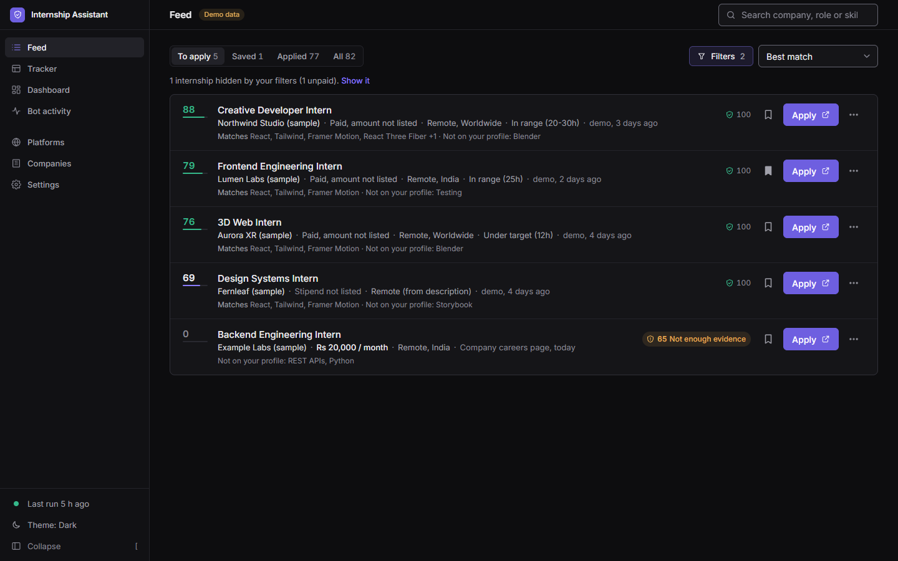 **Feed.** Best match first, each listing with a verification mark. | 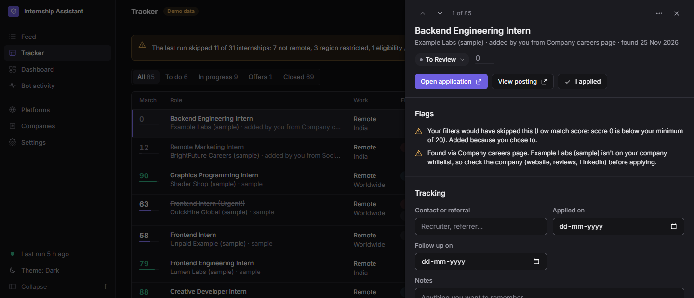 **Unverified company.** The student is told to check the company before applying. |
| 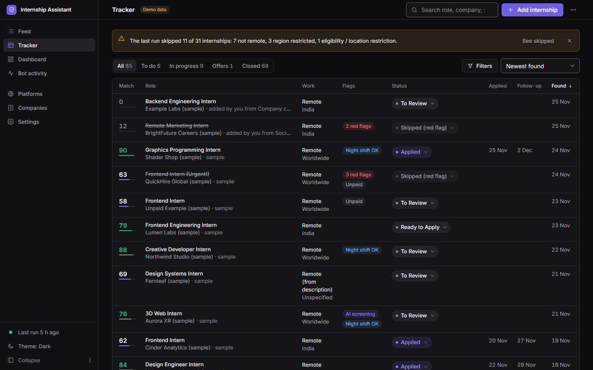 **Tracker.** Match score, flags and status for every listing. | 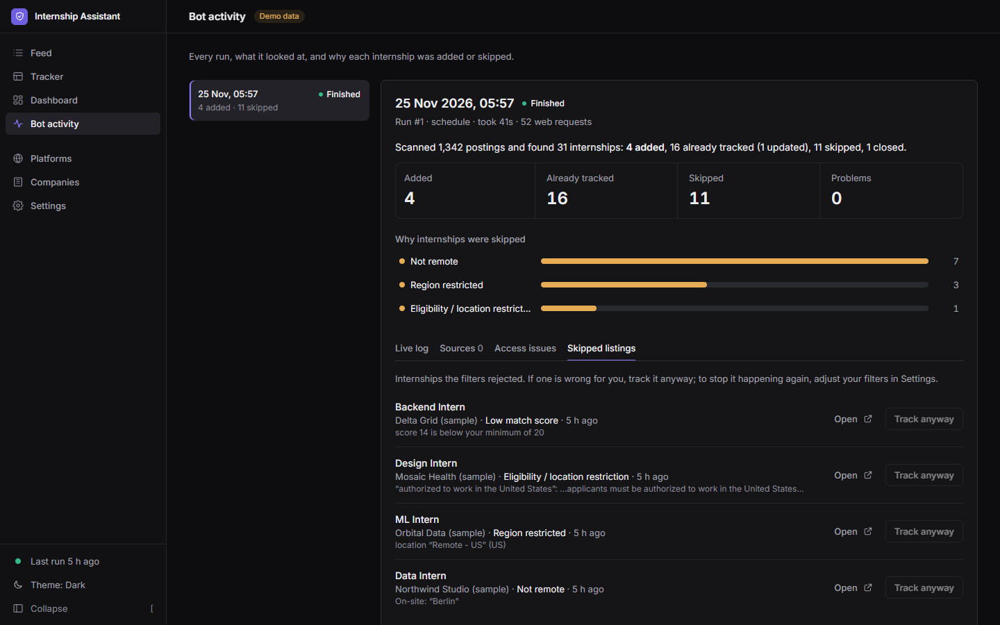 **Skipped listings.** The exact text that made a filter reject a listing, with *Track anyway*. |
| 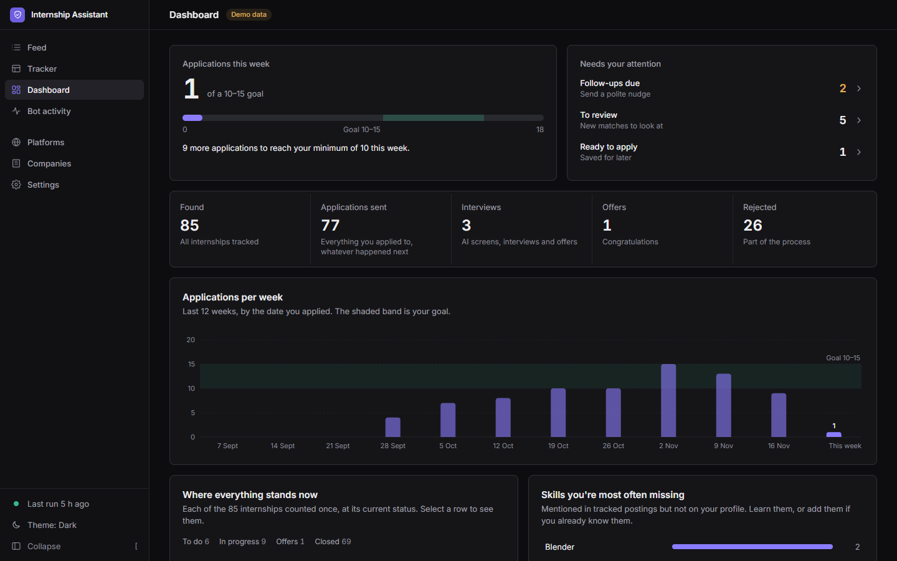 **Dashboard.** Weekly goal, pipeline and weekly applications (sample data). | 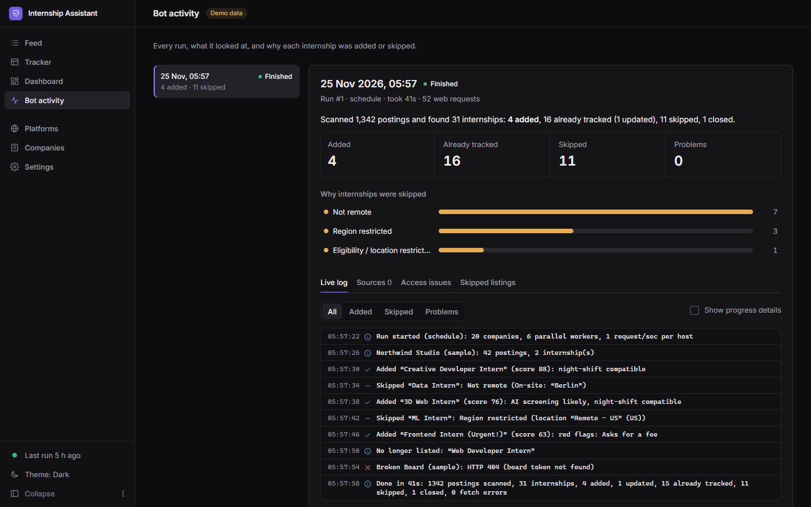 **Bot activity.** What a run scanned, added and skipped, and why. |
| 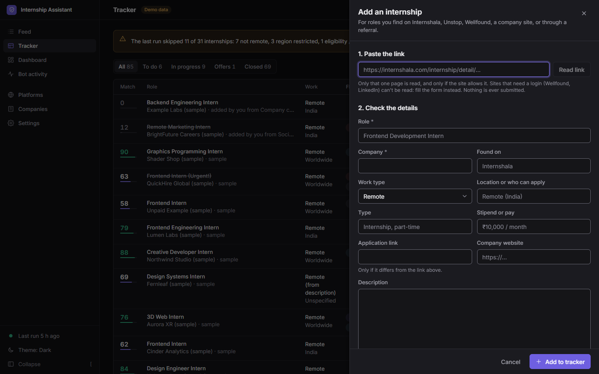 **Add internship.** Paste a link or fill a form; the same analysis runs. | 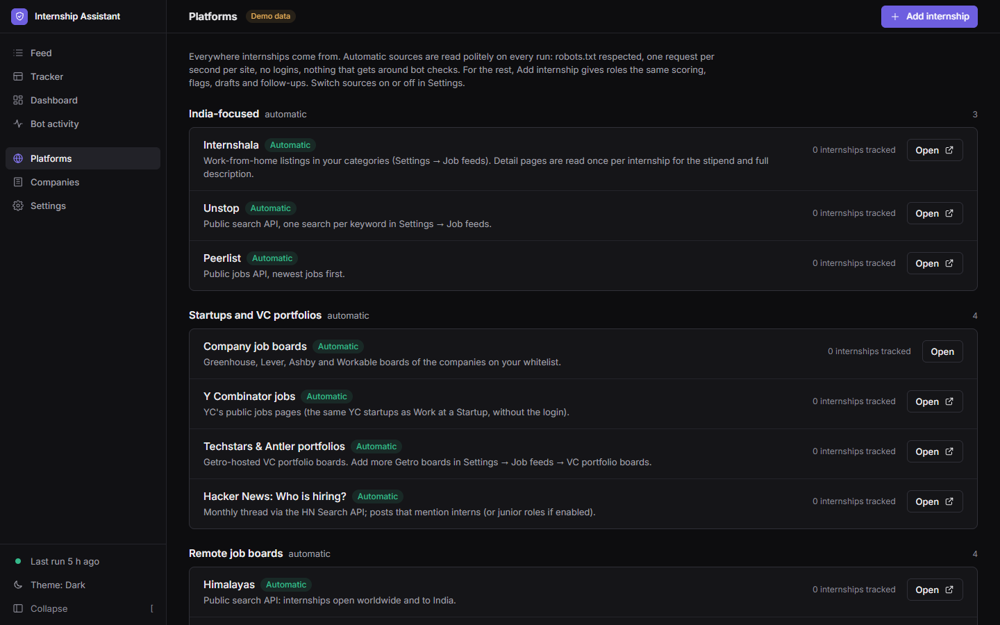 **Platforms.** The sources read automatically and how the rest are covered. |

## Architecture overview

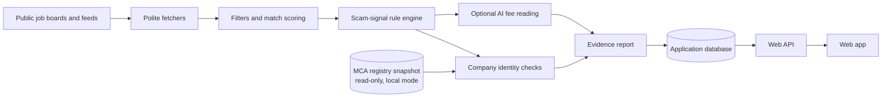

Four detailed diagrams (system, risk-analysis workflow, company verification, registry processing) are in
[`architecture/`](architecture/README.md).

## Technology stack

| Layer | Technology |
|---|---|
| Back end | Python, Flask, Authlib; waitress locally, gunicorn when hosted |
| Data | SQLite (local) and PostgreSQL (hosted) behind one data-access layer; a separate read-only SQLite file for the registry |
| Front end | React 18, TypeScript, Vite, Tailwind CSS, Framer Motion |
| Browser automation | Playwright (optional, local, user-supervised) |
| AI (optional) | Groq or Google Gemini through their public APIs, using the user's own key |
| Hosting and scheduling | Managed web hosting and PostgreSQL, scheduled workflow for daily runs (hosted mode) |
| Quality | Python `unittest` suites, browser-level interface checks, dependency-audit workflow |

## Engineering highlights

- **Evidence-first design.** Every finding carries the text that triggered it; the report lists what could not be checked.
- **Four separate dimensions.** Fraud risk, company identity, recruiter identity and evidence confidence are never merged.
- **A model that must show its quote.** The optional AI reading can only add a finding backed by text that actually appears
  in the advert.
- **Conservative registry matching** over 3,824,308 records, with legal-form agreement, common-name and post-snapshot
  rules; a typo or a parent brand stays *unverified* rather than risking a wrong match.
- **Data-quality layer for public data.** No row is dropped; malformed, placeholder and test records are flagged and kept
  out of matching.
- **Defence in depth.** A connect-time outbound-request guard, encrypted provider keys with rotation, multi-step
  administrator sign-in and persistent rate limits.
- **Honest measurement.** Only the untuned benchmark set is quoted as evidence, and no real-world accuracy is claimed.

## Testing and reliability

| Measure | Result (verified 2026-11-25) |
|---|---|
| Python suite | **395 tests, 0 failures, 11 skipped** (PostgreSQL tests need a test database) |
| Scam-signal benchmark, never-tuned hold-out | **50% of scams marked risky, 0% of legitimate listings marked risky** (10 + 10 hand-written listings) |
| Front-end unit tests | None |
| Browser-level interface checks | Exist; not run for this repository |
| Independent penetration test | Not done |

The 50% figure is deliberately shown: on wording it was never tuned against, the rules alone miss half of the scams.
Details, limits and what the numbers do not show are in [`TESTING.md`](documentation/TESTING.md) and
[`SCAM_DETECTION.md`](documentation/SCAM_DETECTION.md).

## Documentation

| Document | Contents |
|---|---|
| [Product overview](documentation/PRODUCT_OVERVIEW.md) | Problem, users, capabilities, workflow, status |
| [Scam detection](documentation/SCAM_DETECTION.md) | Rule engine, fee detection, AI reading, scoring, benchmark, false positives |
| [Company verification](documentation/COMPANY_VERIFICATION.md) | MCA registry, CIN and name matching, statuses, human review |
| [Security](documentation/SECURITY.md) | Authentication, sessions, SSRF protection, secrets, rate limits, testing |
| [Testing](documentation/TESTING.md) | Strategy, verified counts, coverage boundaries |
| [Engineering decisions](documentation/ENGINEERING_DECISIONS.md) | Decisions, trade-offs, lessons |
| [Architecture diagrams](architecture/README.md) | Four Mermaid diagrams |
| [Screenshots](screenshots/README.md) | Provenance and gaps |

## Current implementation status

| Label | Items |
|---|---|
| **Implemented and verified** | Discovery, filtering, scoring, rule engine, company identity checks, tracker, user isolation, key encryption (all covered by the 2026-11-25 test run) |
| **Implemented, not fully tested** | Optional AI reading (fake model only), hosted multi-user mode (PostgreSQL tests skipped), Google sign-in, browser-assisted apply (no real browser in tests) |
| **Partial** | Full verification report in the interface; server-side auto-apply (no successful submission recorded) |
| **Blocked** | Registry checks in hosted mode (the register needs hosting) |
| **Not built / not launched** | Community reporting, alerts, plans, public launch, independent benchmark dataset |

## Private source-code notice

The source code is private and is not published, mirrored or forked here. This repository contains only documentation,
diagrams and genuine screenshots. No license is granted for the material in this repository.
