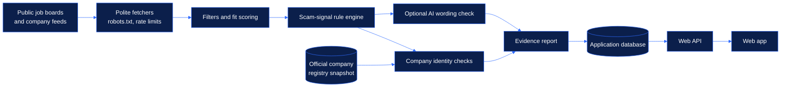

# Trusora

**Know who is really hiring before you apply.**
Trusora (formerly *Scam Shield*) is an internship and company legitimacy verification platform. It reads public internship listings, checks them for scam signals, tries to match the advertised company against official records, and tells the student plainly what it could and could not verify.

> **Notice:** This repository contains public-facing product documentation and visual materials only. The application's source code is maintained separately in a private repository.

---

## The problem

Internship seekers, especially students and first-time applicants, face a flood of listings across job boards, social posts and direct messages. Some are fake: they ask for "registration fees" or deposits, push the conversation to WhatsApp or Telegram, use a free-mail address that imitates a real company, or copy a genuine posting word for word. A student has little time and few tools to tell the difference.

## Who it is for

- Students and early-career applicants looking for internships, with a first focus on India.
- Anyone who wants a second opinion on a listing or a recruiter before sharing documents or money.

## What Trusora does

| Capability | What it means |
|---|---|
| **Internship discovery** | Collects listings from public job boards, company career pages and feeds, politely and without logging in to protected sites. |
| **Fit filtering and scoring** | Keeps internships that match the student's location, remote preference and skills, and explains the match. |
| **Scam-signal analysis** | A transparent rule engine looks for fee demands, off-platform contact, look-alike recruiter addresses, very young company domains, copied postings and similar signals. Each finding shows the exact wording that triggered it. |
| **Optional AI wording check** | An optional language-model reading helps interpret ambiguous money-related wording. The result is quote-checked in code and never replaces the rule engine. |
| **Company identity checks** | Compares the advertised company against official company-registry data, and checks whether the website, recruiter email and hiring channel belong to that company. |
| **Application tracker** | Tracks each internship, with drafts and follow-up reminders. |

## Verified, possible match, or unavailable

Trusora keeps these answers apart and does not merge them into a single "trust" number.

| Result | What it means for the student |
|---|---|
| **Verified** | A record or source matched, and the evidence, source and date are shown. |
| **Possible match** | A name resembles a registered company but cannot be tied to it with confidence (for example, a very common name, or a brand that differs from its registered name). Treated as *not verified*. |
| **Mismatch / conflicting** | The evidence points to a different company, or sources disagree. The student is asked to check before continuing. |
| **Unverified** | Nothing was found to confirm the claim. This is **not** the same as "fake". |
| **Unavailable** | The check could not be run (for example, no registry data is available in that deployment). Shown as a limitation, not as a finding. |

Further principles:

- **It is a ranking with explanations, not a fraud probability.** Trusora does not guarantee that a listing is safe or that a scam will be caught.
- **A registered company is not automatically a safe company.** A valid registration does not outweigh a fee demand or a suspicious recruiter.
- **Company, recruiter and evidence confidence are reported separately**, because a real company can be impersonated.
- Registry data is a snapshot, and every result is shown with its date.

## Architecture overview

More detail is in [`architecture/`](architecture/).

## Security and reliability engineering

Highlights of what has been built into the product (described at a high level only):

- **Guarded outbound requests.** Every request the system makes to the open web goes through a guard that refuses non-public addresses, re-validates redirects and defends against DNS rebinding.
- **Respectful data collection.** `robots.txt` is honoured, requests are rate-limited per host, and there is no sign-in bypassing and no circumvention of bot checks.
- **Secrets handled with care.** Users' optional AI keys are encrypted at rest with key rotation, and are kept out of logs and API responses.
- **Passwordless sign-in.** Single-use sign-in links and Google sign-in in hosted mode; a local-only mode that accepts connections from the same machine only.
- **Abuse limits.** Persistent rate limiting that survives restarts.
- **Evidence over assertion.** Every warning carries the text that triggered it, and the AI check is validated against the source wording before it can influence a result.
- **Honest limits.** The product records what it could not check, so missing data is never presented as a clean result.
- **Testing and review.** An automated test suite, browser-level interface checks, and internal security review and remediation passes.

## Screenshots

Real product screenshots will be added here once they have been reviewed for personal data. No mock-ups are presented as the working product.

| Screen | Status |
|---|---|
| Internship feed with verification marks | _Placeholder, screenshot to be added_ |
| Internship detail drawer with evidence report | _Placeholder, screenshot to be added_ |
| Company identity checks | _Placeholder, screenshot to be added_ |
| Application tracker | _Placeholder, screenshot to be added_ |
| Dashboard | _Placeholder, screenshot to be added_ |

See [`screenshots/`](screenshots/) for the capture guidelines.

## Demonstration

A short walkthrough video will be linked here.
_Placeholder, link to be added._ See [`demonstrations/`](demonstrations/).

## Technology stack

| Layer | Technology |
|---|---|
| Backend | Python, Flask |
| Data | SQLite (local) and PostgreSQL (hosted), behind one data layer |
| Frontend | React, TypeScript, Vite, Tailwind CSS |
| Browser automation | Playwright (optional, local, user-supervised) |
| AI (optional) | Groq or Google Gemini through their public APIs |
| Quality | Python `unittest` suites and browser-level interface checks |

## Development status

Trusora is **under active development** and is **not publicly launched**.

| Area | State |
|---|---|
| Internship discovery, filtering and scoring | Built and in use during development |
| Scam-signal rule engine with evidence output | Built; being evaluated and tuned |
| Company identity checks against registry data | Built; registry-backed checks currently run only where registry data is installed locally |
| Optional AI wording check | Built; requires the user's own provider key |
| Showing the full verification report in the web app | In progress |
| Public launch, community scam reporting, alerts and plans | Not built |

Detection quality is still being measured. No accuracy figures are published yet, and none should be assumed.

## Private source-code notice

The source code is private and is not published, mirrored or forked in this repository. This repository only holds documentation, diagrams and visual materials.
