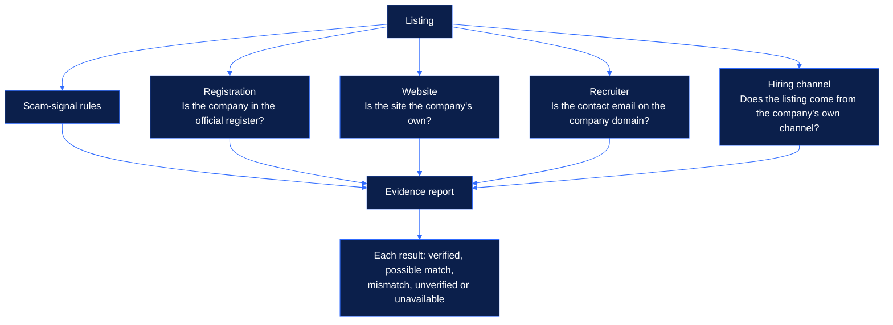

# Architecture

High-level diagrams for Trusora.

## Verification model

Four questions are answered separately, each with its own status, evidence and date:

More diagrams (data flow, deployment modes) will be added here later.
