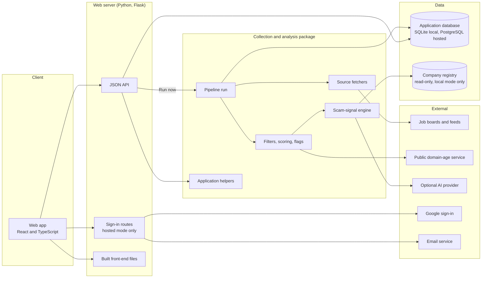
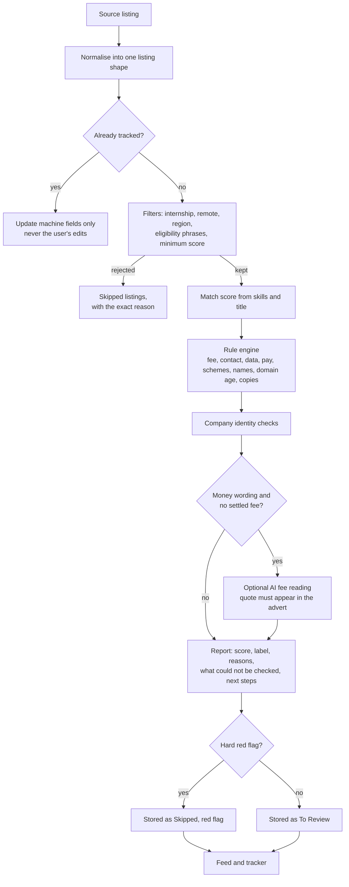
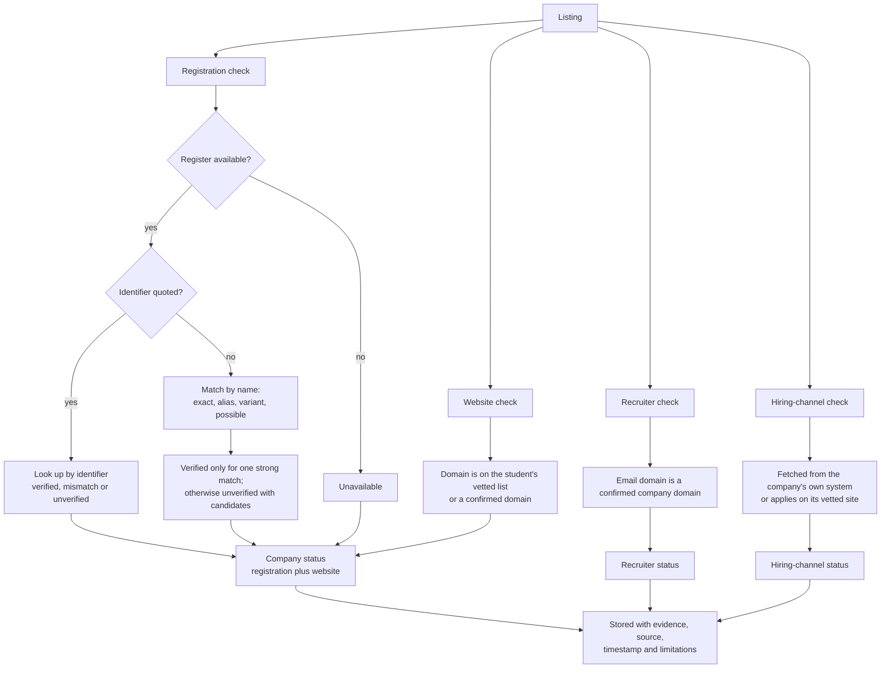
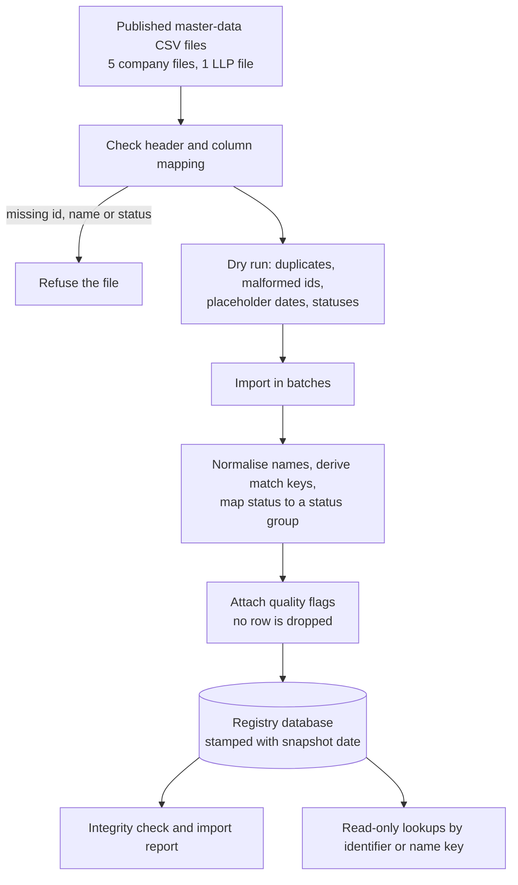

# Architecture

Sanitised diagrams of the architecture that is **implemented today** in the private repository (inspected 2026-11-25).
They show components and data flow, not code. Diagrams render on GitHub.

| Diagram | Section |
|---|---|
| Overall system architecture | [1](#1-overall-system-architecture) |
| Internship risk-analysis workflow | [2](#2-internship-risk-analysis-workflow) |
| Company verification workflow | [3](#3-company-verification-workflow) |
| Registry data processing workflow | [4](#4-registry-data-processing-workflow) |

## 1. Overall system architecture

One codebase runs in two modes. **Local mode** serves a single user on their own computer with a local database and no
sign-in. **Hosted mode** serves many users, each with their own profile and tracker, on a managed database. The company
registry is available only in local mode.

Notes:

- Every request from the server to a third-party site passes through a guard that validates the destination address
  (see the [security overview](../documentation/SECURITY.md)).
- A scheduled run is started by the operating system's task scheduler locally, or by a scheduled workflow in hosted mode.
- The browser-assisted applier is a separate local command that drives the user's own browser; it is not part of the
  web server.

## 2. Internship risk-analysis workflow

What happens to one listing between being read from a source and being shown in the feed.

## 3. Company verification workflow

Four checks; the company status combines registration and website, and the recruiter status is kept separate.

## 4. Registry data processing workflow

How public company and LLP records become a read-only lookup file.

Scale (re-verified 2026-11-25): 3,824,308 records, of which 3,236,968 are companies and 587,340 are LLPs; the file is
about 2.33 GB. The snapshot date stamped on every record is 4 October 2026.
