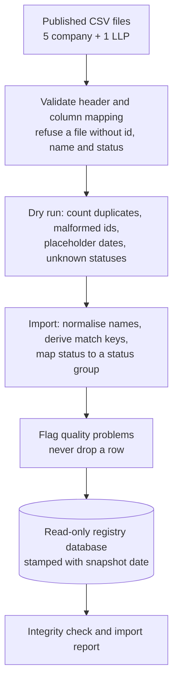
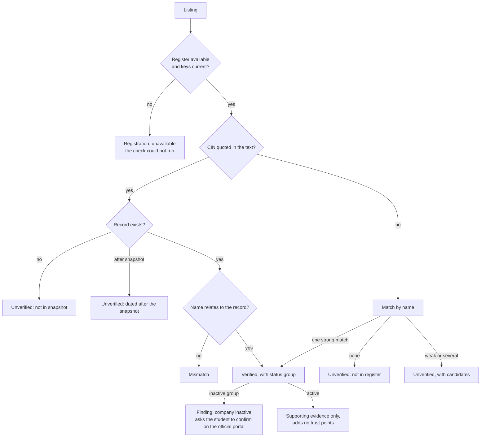

# Company verification

How Trusora checks whether the company behind a listing exists in official records, and how it reports the answer.
Counts below were re-verified against the local register file on 2026-11-25 (read-only queries); other figures are
marked with the date they were recorded.

> **In the interface today.** The identity checks run and their results are stored with each listing, but the web
> interface does not yet display the separate company, recruiter and evidence-confidence fields. See
> [SCAM_DETECTION.md](SCAM_DETECTION.md#8-how-risk-evidence-reaches-the-user).

## 1. Four separate questions

Each question has its own status, evidence, source, timestamp and list of limitations.

| Check | Question |
|---|---|
| **Registration** | Is the advertised company in the official register under this name, and what is its status? |
| **Website** | Is the advertised website the company's own? |
| **Recruiter** | Is the contact email on the company's own (confirmed) domain? |
| **Hiring channel** | Is the listing tied to the company's own hiring channel (its applicant-tracking system, or its vetted careers site)? |

Statuses for each check: **verified**, **mismatch**, **unverified**, **conflicting**, **unavailable**.

The overall *company* status combines only registration and website. The *recruiter* status is kept apart, because a
real company can be impersonated by a recruiter who is not theirs.

## 2. The registry

| Fact | Value |
|---|---|
| Source | Ministry of Corporate Affairs *Company Master Data* and *LLP Master Data*, as published on data.gov.in |
| Snapshot date | **4 October 2026** (stated by the portal; stored on every record) |
| Records | **3,824,308**, made up of **3,236,968 companies** and **587,340 LLPs** (counted by kind) |
| Files imported | Five company files and one LLP file, downloaded 2026-11-11 |
| Storage | A separate read-only database file, about **2.33 GB**; the application opens it read-only and a write attempt is refused |
| Integrity | `integrity_check` and `quick_check` passed at import (recorded 2026-11-12) |
| Availability | Local installs that have the file. **Hosted deployments do not**; there, registration reads *unavailable* |

### What a registry record contains (high level)

| Field | Purpose |
|---|---|
| Identifier | The 21-character CIN for companies, or the LLPIN for LLPs; the primary key |
| Kind | Company or LLP |
| Name, plus normalised keys | The registered name and searchable keys derived from it (see name matching below) |
| Status and status group | The published status exactly as given, plus a group: active, struck off, closing, closed, insolvency, converted, dormant, inactive, other |
| Incorporation date | ISO date; placeholder dates are kept raw and stored as unknown |
| State, registrar of companies, category, class, sub-category, industry | Supporting evidence |
| Snapshot date and quality flags | Provenance and data-quality markers set at import |

Related tables (aliases, domains, third-party records, change history) exist in the schema but were **empty** when
checked on 2026-11-25. Address, capital and contact details are **not** imported, and the source files contain no email
column, so **no company website can be tied to a company from this data**. Website and recruiter checks rely on the
student's own vetted company list or the company's own applicant-tracking system.

## 3. Registry data processing

Import properties recorded in the inspection log (2026-11-12):

- **Nothing is dropped.** Every problem row is imported with quality flags and appears in the import report.
- **Unique identifiers:** zero repeated ids across all files.
- **Flagged categories** include malformed ids, placeholder and future dates, names with no usable words, mis-encoded
  names, records registered after the snapshot date, and suspected test records. Placeholder-named and test records are
  never matched.
- **Key versioning.** Stored name keys carry a normaliser version; a register built with an older version is refused
  until its keys are rebuilt, so matching rules and data cannot silently drift apart.

## 4. Verification workflow

## 5. CIN matching

When a listing quotes a CIN or LLPIN, the record is looked up directly. If it exists and its name relates to the
advertised company, registration is **verified**. If the identifier belongs to a company with an unrelated name, the
result is a **mismatch**, which raises a medium-severity finding (it may be a trading name, so the student is asked to
check). If the identifier is not in the snapshot the result is **unverified**, with the limitation that companies
registered after the snapshot are not in it.

In practice this path is rare: of 2,093 stored listings examined on 2026-11-12, **none quoted a CIN**, so name matching
does most of the work.

## 6. Name matching

Levels are tried in order, and legal-form words (Pvt, Private, Ltd, Limited, LLP and similar) are dropped from the key.

| Level | Meaning | Can be *verified*? |
|---|---|---|
| Exact | Normalised names are equal | Yes, if exactly one record matches |
| Alias | A recorded former or trading name | Yes (no aliases are loaded today) |
| Variant | Descriptor spellings folded, such as "Tech" and "Technologies" | Yes, if exactly one record matches |
| Possible | Only the distinctive words agree | **Never**; shown as a candidate |

### Legal-form validation

Legal forms must agree. A listing that says *LLP* is not verified against a *private limited* company of the same name,
and the reverse. Foreign legal forms (Inc, Corporation, LLC, GmbH, Pte) count as part of the name rather than being
discarded.

### Downgrades to "possible" (never verified)

- The listing gives no Indian legal form and the distinctive words are shared by many registered companies (a common name).
- The only match is an inactive namesake, for example a foreign company sharing a name with a struck-off Indian one.
- Several records match and the listing gives no identifier to tell them apart.

## 7. Verification statuses and what they mean

| Status | Meaning for the student |
|---|---|
| **Verified** | A record matched under the rules above. Evidence, source, snapshot date and limitations are shown. Not a safety guarantee. |
| **Possible match** (reported as *unverified* with candidates) | A name resembles a registered company but cannot be tied to it with confidence. Treated as not verified. |
| **Mismatch** | The identifier or domain points to a different company. The student is asked to check before continuing. |
| **Conflicting** | Sources disagree. Reserved for third-party data; none is loaded today, so it was not observed. |
| **Unverified** | Nothing was found to confirm the claim. **Not evidence of a scam.** Foreign employers, brands and unregistered start-ups land here. |
| **Unavailable** | The check could not run (for example no register in this deployment). The report says this means the check could not run, not that the company does not exist. |

An *active* registration is recorded as supporting evidence only. It adds **no** trust points and cannot offset a fee
demand, a request for a one-time password or a look-alike recruiter.

Three registry-derived facts can feed the risk score, all at modest weight: the company is inactive (struck off,
closing, closed or in insolvency), the quoted identifier belongs to a different name, or a recruiter or website domain
looks like the real one.

## 8. Unmatched and ambiguous records

- **Not found** is reported as *unverified*, with the note that a missing match is not evidence of a scam.
- **Several candidates** are reported as *unverified* and listed, rather than guessing one.
- **Records dated after the snapshot** (236 on import: 232 dated 5 October 2026 and 4 test records) are flagged. If one of
  several namesakes is post-snapshot the result is ambiguous, never a verified match to the other one. The import
  record measured zero verified matches from them.
- **Test and placeholder records** (five were flagged) are excluded from every lookup.

## 9. Human review requirements

Trusora does not make an automatic decision about a company.

- A *verified* registration is evidence for the student to weigh, not a clearance.
- An *inactive* status prompts the student to **confirm the current record on the official portal**, because the
  snapshot is dated and a company may have been struck off or revived since.
- Name-only matches carry the limitation "matched by name". Name matches are weaker than identifier matches, and the
  register contains many near-identical names.
- In the recorded real-listing trial (2026-11-12, 881 distinct companies), 189 name-only matches were written to a
  **review file** for a human to inspect, and the author flagged four as worth a manual check (including an Indian arm
  matched to a foreign parent brand).

## 10. Measured behaviour (recorded 2026-11-12, not re-run on 2026-11-25)

A matching benchmark builds cases from register rows, so the right answer is known by construction (200 cases per kind,
two seeds). It measures the matcher, **not real-world accuracy**.

| Case | Correct | Missed safely | Wrong match |
|---|---:|---:|---:|
| Exact identifier | 100% | 0% | 0% |
| Exact name with legal suffix | 99-99.5% | 0.5-1% | 0% |
| Name without legal suffix | 96-97.5% | 2.5-4% | 0% |
| Descriptor variant | 92-94% | 6-8% | 0% |
| One-letter typo | 0% | 100% | 0% |
| Parent brand of an "X India" company | 0% | 99-100% | 0-1% |
| Absent from the register | 100% | 0% | 0% |

A one-letter typo or a parent brand is deliberately **not** matched, so it stays *unverified* rather than risking a
wrong match.

Real-listing coverage on 2,093 stored listings (881 distinct companies, 2026-11-12): registration was verified for 374
listings and unverified for 1,719. Of the distinct companies, 183 were verified by exact name, 1 by variant, 219 were
possible matches only, and 478 were not in the register. **Unverified is not negative**: foreign employers, brands and
unregistered start-ups all land there.

## 11. Limitations

1. The register is a **snapshot**, dated 4 October 2026. A company struck off afterwards looks active, and one revived
   afterwards looks struck off. Every status is shown with its snapshot date.
2. No email column exists in the source data, so website and recruiter checks cannot be derived from it.
3. Renamed companies and trading names need an alias record with a source; none is loaded, so they stay *unverified*.
4. Real listings rarely include a CIN or a recruiter email (27 of 2,093 gave an email), so the recruiter check usually
   has nothing to check.
5. No careers-page crawling: "no careers page on file" is a limitation, not a finding.
6. Not available in hosted deployments.
7. Third-party data can only raise a *conflicting* result and never sets a status; none is loaded today.
