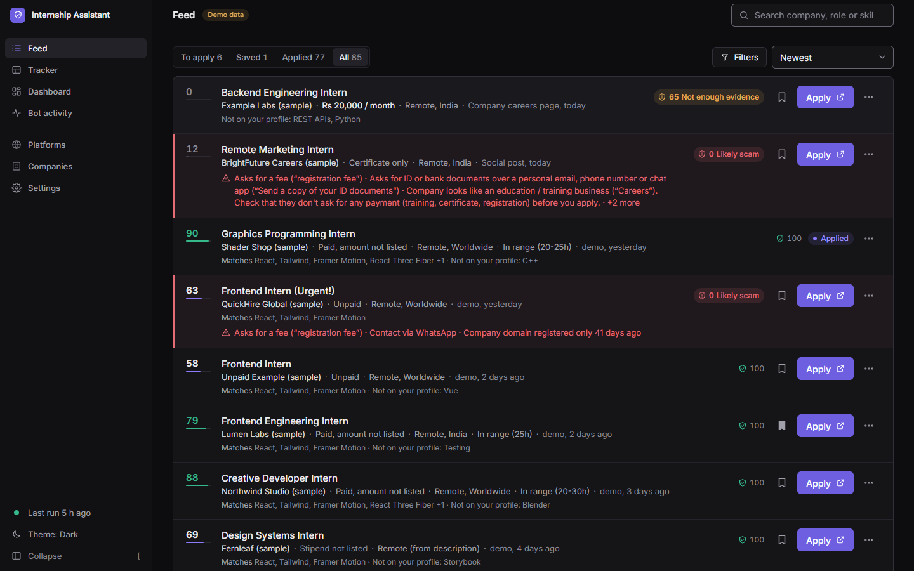
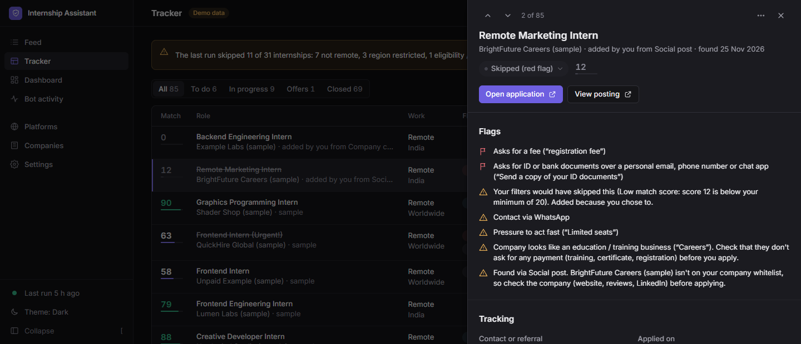
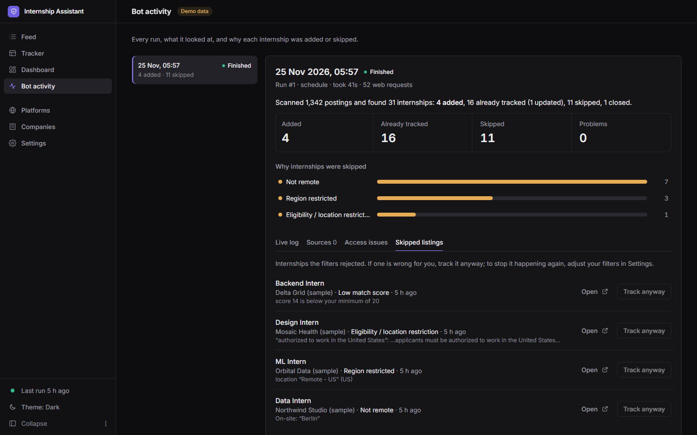

# Product overview

> **Trusora** (formerly *Scam Shield*) is an internship and company legitimacy verification platform.
> This page describes what the product does today, based on the running application and its private repository
> as inspected on 2026-11-25.

**Naming note.** The running application currently presents itself as **"Internship Assistant"** in its interface;
the legitimacy engine inside it was developed under the name Scam Shield. The name Trusora does not yet appear in the
application's interface, so the screenshots in this repository show the interface as it is today.

## 1. The problem

Students looking for internships meet listings from job boards, company career pages, social posts and direct
messages. Some of those listings are fraudulent. Typical patterns are an upfront "registration" or "training" fee, a
request to move the conversation to WhatsApp or Telegram, a request for identity or bank documents over chat, a
recruiter writing from a free mailbox, or a posting copied word for word under another company's name.

Checking each listing by hand means searching the company, reading the posting for warning signs, and finding out
whether the company is registered at all. That takes time that most applicants do not have, and the first-time
applicants who most need the checks are the ones least likely to know what to look for.

## 2. Who it is for

- **Students and first-time applicants**, with a first focus on India (the company-registry checks use the Indian
  Ministry of Corporate Affairs register).
- **Anyone who wants a second opinion** on a listing or recruiter before sharing documents or money.

## 3. What the product does

| Capability | Description | Status |
|---|---|---|
| Internship discovery | Reads public job boards, feeds and company career-page APIs on a schedule, politely (robots.txt respected, rate limits, no logins). Listings can also be added by pasting a link or filling a form. | Implemented and tested |
| Filtering and scoring | Keeps internships that are internships, remote (or in an allowed location), open to the student's region, and a fit for their skills; produces a 0-100 match score with matched and missing skills. | Implemented and tested |
| Scam-signal analysis | A rule engine produces *findings*, each with the exact wording that triggered it, a severity, an explanation and a next step. See [SCAM_DETECTION.md](SCAM_DETECTION.md). | Implemented and tested |
| Optional AI wording check | A language model answers one question about the advert text (does the applicant have to pay?). The answer is checked in code before it can affect anything. | Implemented and tested with a fake model; not measured on real listings |
| Company identity checks | Compares the advertised company against Indian company and LLP registry data, and checks the website, recruiter email and hiring channel. See [COMPANY_VERIFICATION.md](COMPANY_VERIFICATION.md). | Implemented and tested; registry data is only available where the register file is installed locally |
| Application tracker | Status tracking across eleven statuses, follow-up dates, notes, drafted cover notes and prefilled answers. | Implemented and tested |
| Dashboard and activity log | Weekly goal, pipeline counts, per-run log of what was added or skipped and why. | Implemented |
| Browser-assisted apply | A local command-line tool that fills application forms in a browser the student has already signed in to. It never logs in, solves CAPTCHAs or submits without a visible confirmation. | Implemented; local use only |

## 4. The user workflow

1. **Discover.** A scheduled run (or a manual run) reads the configured sources. Each listing is filtered, scored and
   analysed for scam signals before it is stored.
2. **Review the feed.** The feed shows the best matches first. Each row carries a verification mark: a quiet green
   check, an amber *Not enough evidence* pill, or a red *Likely scam* pill with the top reasons.
   
3. **Open a listing.** The detail panel lists flags and warnings, each in plain language.
   
4. **Decide and track.** The student saves, applies and tracks the listing. Listings with a hard red flag start as
   *Skipped (red flag)* but can be tracked anyway.
5. **Learn from the activity log.** *Bot activity* shows each run, and *Skipped listings* shows the exact text that made a
   filter reject a listing, with a *Track anyway* button.
   

## 5. What the product does not claim

- It is an **explainable ranking, not a fraud probability.** It does not guarantee that a listing is safe or that a
  scam will be caught.
- **"Unverified" is not "fake".** Foreign employers, brands and young start-ups often cannot be matched to a registry
  record.
- **A registered company is not automatically a safe company.** Registration never offsets a fee demand or a
  suspicious recruiter.
- No real-world accuracy figure exists yet (see [SCAM_DETECTION.md](SCAM_DETECTION.md#9-measured-behaviour-and-what-it-does-not-show)).

## 6. Current implementation status

Status vocabulary used across this repository:

| Label | Meaning |
|---|---|
| **Verified** | Observed working in the running application, or covered by a test run on 2026-11-25 |
| **Implemented, not independently tested** | Code exists and is in use; no automated test covers it |
| **Partial** | Part of the feature works |
| **Not built** | Mentioned in product copy or plans only |

| Area | Status |
|---|---|
| Discovery, filtering, scoring, de-duplication, edit preservation | Verified (automated tests) |
| Scam-signal rule engine and evidence output | Verified (automated tests, benchmark) |
| Optional AI fee reading | Verified with a fake model only; no live-provider test |
| Company identity checks | Verified (automated tests); registry-backed checks need the local register file |
| Full verification report in the web interface | **Partial.** The feed mark and the flags list are shown; the separate company, recruiter and evidence-confidence fields are computed and stored but not yet rendered |
| Multi-user hosted mode | Implemented; the hosted deployment itself was not verified in this review |
| Browser-assisted apply | Implemented; unit-tested without a real browser |
| Server-side auto-apply | **Partial.** Implemented and tested against mocks; no successful submission is recorded |
| Registry in hosted mode | **Not available.** The register file is too large for the hosted database, so hosted deployments report registration as *unavailable* |
| Community scam reporting, plans, alerts | **Not built** |
| Public launch | **Not launched** |

## 7. Screenshots

All screenshots were captured from the running application using its built-in sample data (marked *Demo data* in the
interface) and two synthetic listings added through the interface. No real user data is shown.
See the gallery in the [README](../README.md#screenshots) and the notes in [`screenshots/`](../screenshots/README.md).
