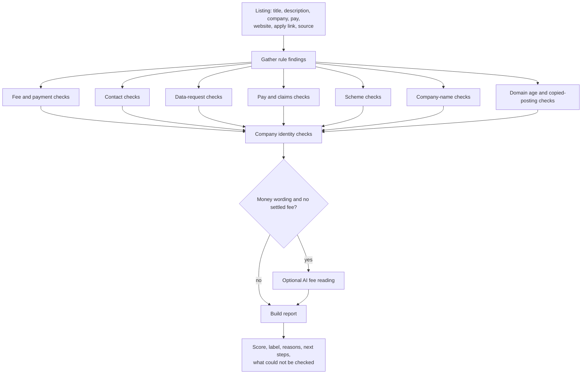
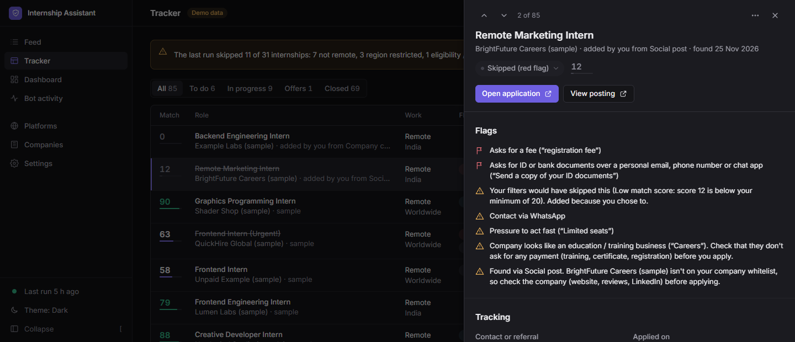
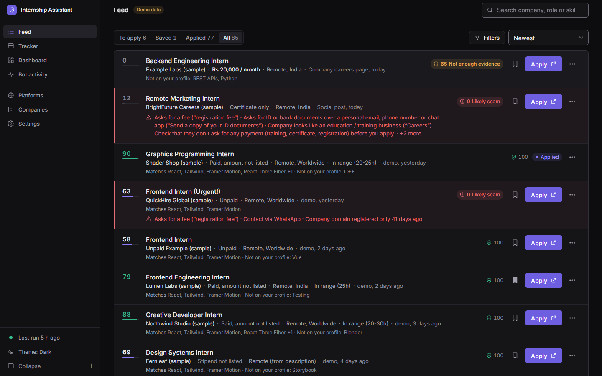
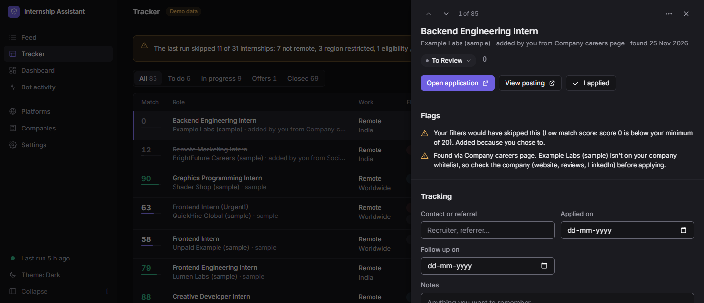

# Scam detection

How Trusora analyses a listing for scam signals. Everything here describes behaviour observed in the private
repository on 2026-11-25. Implementation details that would help someone craft a listing to slip past the checks
(exact patterns, thresholds and wordlists) are deliberately left out.

## 1. Design principles

- **Evidence, not opinion.** A finding is only produced when specific text, a data field or a registry fact supports it,
  and the finding carries that evidence (for example the matched words, shown with a little surrounding text).
- **Explainable ranking, not a probability.** The score orders listings by how much concern the evidence raises. It is
  not a probability of fraud and is never presented as one.
- **Separate dimensions.** Fraud risk, company identity, recruiter identity and evidence confidence are reported as
  separate fields rather than merged into one number (see [COMPANY_VERIFICATION.md](COMPANY_VERIFICATION.md)).
- **Say what was not checked.** Every report lists what could not be verified, so missing data never reads as a clean
  result.
- **Rules first, AI second.** Deterministic rules do the main work. A language model is used for one narrow question
  and can only add a finding that is backed by a quote from the advert.

## 2. Pipeline

The order inside a run is: gather rule findings, verify identity, optional AI reading, convert findings into tracker
flags and warnings, then build the report.

## 3. Rule-based evidence evaluation

Findings fall into groups. A group is a family of related evidence, and the score treats the strongest finding in a
group most heavily, so ten variations of the same warning do not outweigh one serious sign.

| Group | What it looks for |
|---|---|
| Money | Upfront fees for registration, training, security deposits, certificates or kits; "pay first" phrasing; rupee amounts next to charge words. Exclusions handle denials ("no fee"), income words (stipend, salary), the company as payer and third-party business payments. |
| Data | Requests for one-time passwords, card security codes or payment PINs (critical); requests for identity or bank documents, and especially such requests combined with a personal email or chat app. |
| Contact | Off-platform contact (WhatsApp or Telegram, including obfuscated spellings), applications sent to a free personal mailbox, a contact email that does not match the company, link shorteners. |
| Identity | The company is on the student's personal blocklist; the same posting text appears under other company names; the company name looks like a training or education business; no website on file for a company that should have one. |
| Domain | The company website's domain was registered very recently (looked up through public RDAP data; failed lookups are cached as "age unknown"). |
| Pay and claims | Unpaid with no interview, commission-only or earnings claims, guaranteed outcomes, "no interview needed", pressure to act quickly. |
| Schemes | Trading-course and multi-level-marketing patterns. |
| Registry | The company is struck off or closing, or the quoted registration number belongs to a different name. |

**Severity and effect.** Rules are weighted *critical*, *high*, *medium* or *low*. Some rules are *hard*: they also set
a tracker red flag, so the listing starts as *Skipped (red flag)* (the student can still track it). All weights live in
a single table, separate from the code that finds the evidence.

## 4. Fee-related warning detection

The fee check is the most important rule. It works on normalised text (invisible characters removed, look-alike
characters folded, so simple obfuscation does not hide a fee) and combines:

- fee nouns with a payer context (registration, training, security, deposit);
- must-pay and pay-first phrasing;
- rupee amounts near charge words;
- exclusions: denials, income words, the company as payer and third-party business payments.

The evidence shown to the student is the matched words. For a fee demand the next steps include *do not pay anything*
and, in India, reporting to the national cybercrime portal.

*The listing above is a synthetic example added through the interface for this repository. Its company name is
fictional.*

## 5. Domain and posting signals

| Signal | Implemented | Notes |
|---|---|---|
| Company domain age (RDAP) | Yes | Needs network access to a public RDAP service; a failed lookup is recorded as unknown. Not covered by a live test; an offline stale-cache case is tested. |
| Copied posting text under other company names | Yes | Compares against previously seen postings stored locally. |
| Look-alike recruiter or website domains | Yes | Part of the company identity checks. |
| Personal-mailbox or mismatched contact email | Yes | |
| Content of the employer's website, attachments, images, PDFs | **No** | Text only. |
| Reports from other users | **No** | No community signal exists. |

## 6. Scoring in outline

1. Start from a base that reflects who is behind the listing: highest for a verified employer (the student's own list or
   the company's own applicant-tracking system), lower for a job-board listing, lowest for pasted text with no source.
2. Subtract points per group, counting the largest finding fully and further findings in the same group at reduced weight.
3. A **critical** finding caps the score at a low value.
4. With no critical or high finding and few distinct groups, the score has a floor, so mild evidence reads as *Check
   first* and never as *Risky*.
5. If every suspicious finding came from the AI reading, the score has the same floor.

Labels shown to the student: **Looks legit** (only for a verified employer), **No red flags found**, **Not enough
evidence**, **Check first**, **Risky**, **Likely scam**. A silent absence of findings never produces *Looks legit*.

*Top to bottom, the feed shows an amber "Not enough evidence" listing, two red "Likely scam" listings, and green checks
on sample listings.*

## 7. LLM-assisted semantic analysis

**Implemented.** An optional language-model reading asks exactly one question about the advert:

> Does the applicant have to pay, buy, deposit, or take on any mandatory financial obligation to apply, be selected,
> join, be trained, or get the certificate or offer letter?

- **Selective.** It runs only when the text contains money-obligation wording or a non-income amount, and not when a
  rule already settled the matter. In the one measurement recorded (2026-11-12) about 8% of listings triggered it.
- **Untrusted input.** The advert is delimited as data in the prompt, with an instruction never to follow it.
- **Validated in code.** The reply must be valid structured output. A "yes" or "unclear" must include a quote that
  actually appears in the advert (spacing and quote styles ignored); otherwise it is downgraded to "unclear" and
  produces no finding. Any amount must appear inside the verified quote.
- **Bounded.** Results are cached by a hash of the advert text, calls have a timeout, a minimum interval and a daily
  limit, and three failures in a row switch the reading to "unavailable".
- **Needs a key.** It requires the user's own provider key. Without one its status is *off* and rules alone decide.
- **Limited influence.** AI-only findings carry less weight than rule findings and cannot push a listing below the
  "check first" floor on their own.

**What is verified:** the validation, gating, caching, limit and failure paths, with a scripted fake model (35 tests).
**What is not verified:** precision and recall on real listings (no labelled set), and robustness against adversarial or
prompt-injection adverts (not separately tested).

## 8. How risk evidence reaches the user

| Where | What is shown |
|---|---|
| Feed row | Verification mark (check, amber pill or red pill) with the score and label; the top reasons for risky listings. |
| Detail panel | A **Flags** list: hard findings (red flag icon) and warnings (amber icon), each in plain language. |
| Stored report | The full report: score, level, label, reasons, verified facts, what could not be checked, next steps, and each finding with its evidence and source. |

> **Limitation.** Only part of the stored report is rendered today. The separate company-identity, recruiter-identity
> and evidence-confidence fields, the "what could not be checked" list and the next steps are computed and stored but not
> yet shown in the interface.

## 9. Measured behaviour, and what it does not show

The rule engine ships with a benchmark of hand-written listings (`shield_benchmark`). It was re-run on 2026-11-25 and
reproduced the numbers recorded on 2026-11-12.

| Set | Scams | Legitimate | Scams marked risky | Legitimate marked risky | Note |
|---|---:|---:|---:|---:|---|
| Tuned corpus | 36 | 36 | 100% | 0% | Rules were adjusted against these; shows the rules behave as designed on known examples |
| Hold-out A | 15 | 15 | 100% | 0% | Tuned against after it was written |
| Hold-out B | 12 | 12 | 91.7% | 0% | Tuned against after it was written; one scam marked safe |
| **Hold-out C** | 10 | 10 | **50.0%** | 0% | **Never tuned against.** Five of ten scams were not recognised |

**How to read this.**

- Only hold-out C is an honest figure for unseen wording, and it is 10 + 10 hand-written listings. On it the rules
  alone **miss half of the scams**. The missed examples were short listings for data-entry, typing, sales and similar
  roles whose wording the rules did not recognise.
- The benchmark runs rules only. Whether the optional AI reading catches the misses was **not measured**.
- A frozen, independent 200-listing benchmark protocol exists, but **no such dataset has been built and no result
  exists**. There is no real-world accuracy figure for the product, and none is claimed.

## 10. Limitations and false-positive considerations

| Kind | Case |
|---|---|
| False negative (measured) | One hold-out B scam and five of ten hold-out C scams were marked safe by the rules. |
| False negative (by design) | Typos and parent brands are not matched to registry records; they stay *unverified*. |
| False positive risk | Legitimate small firms that contact applicants on WhatsApp or from a free mailbox receive a *Check first* result. These are medium-weight signals, treated as a reason to verify, not proof. |
| False positive risk | Company names containing words such as "training", "academy" or "internship" can trigger the education-business check. |
| False positive risk | A whitelisted company without a website on file is skipped by a hard rule even though its score stays above the "risky" range. |
| Possible false registry match | Name-only matches to the Indian arm of a foreign company, or to unrelated namesakes. See [COMPANY_VERIFICATION.md](COMPANY_VERIFICATION.md). |
| Not measured | Precision and recall of the AI reading; robustness against adversarial adverts. |
| Structural | Text only; no community signal; the registry is a dated snapshot and is not available in hosted mode. |
| Coverage | Listings stored before the current engine existed use an older, simpler trust score until they are re-checked. |
